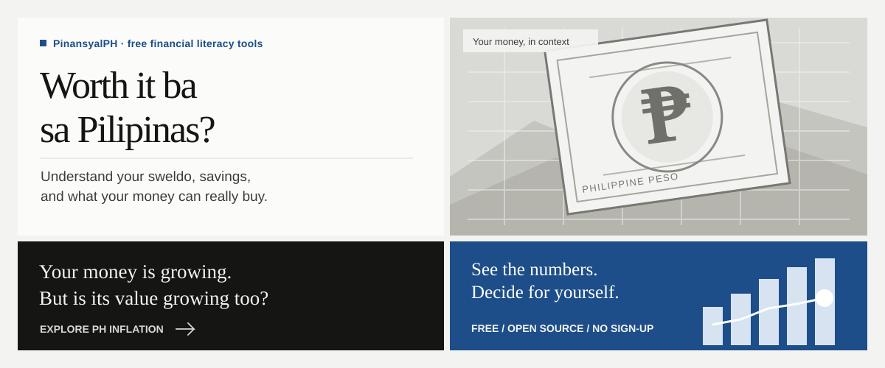
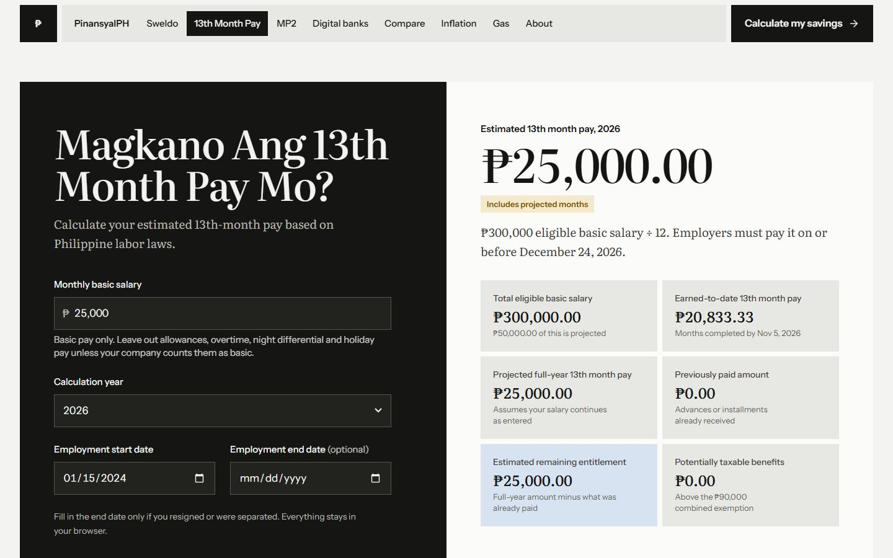
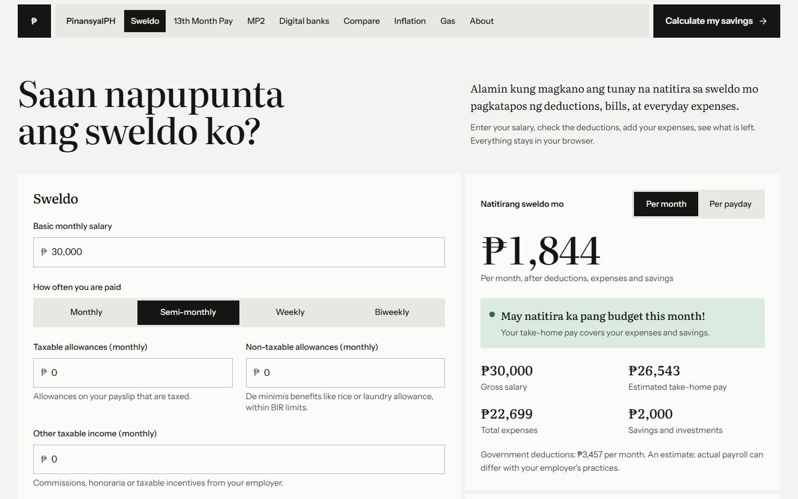
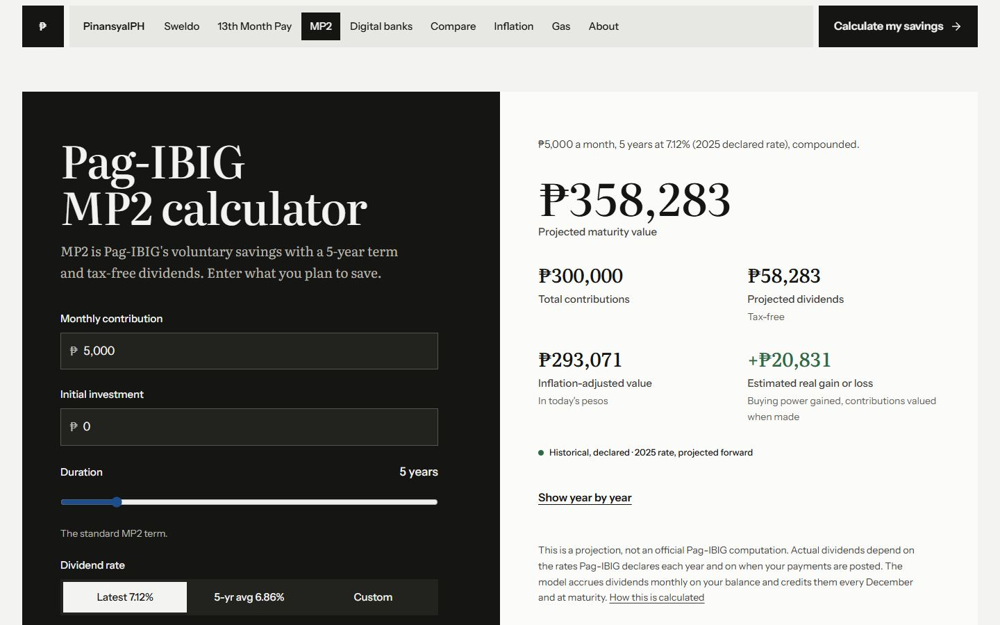
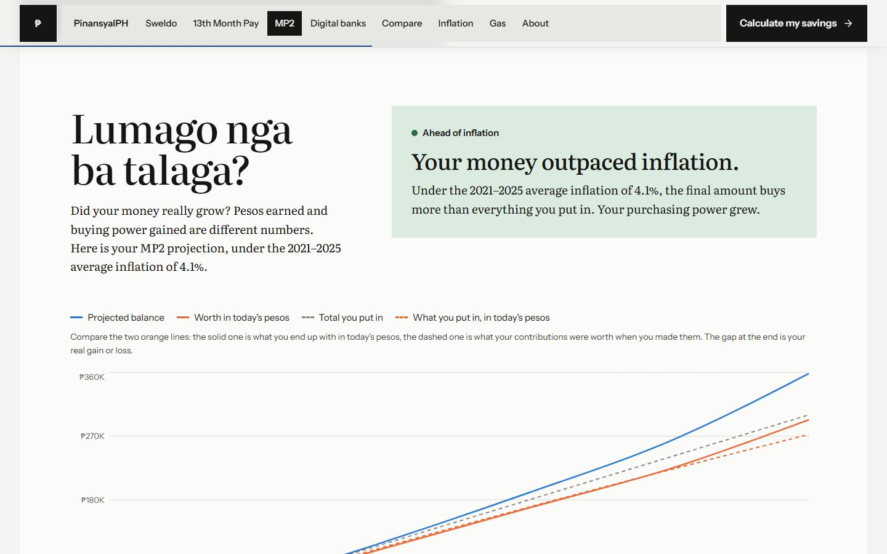
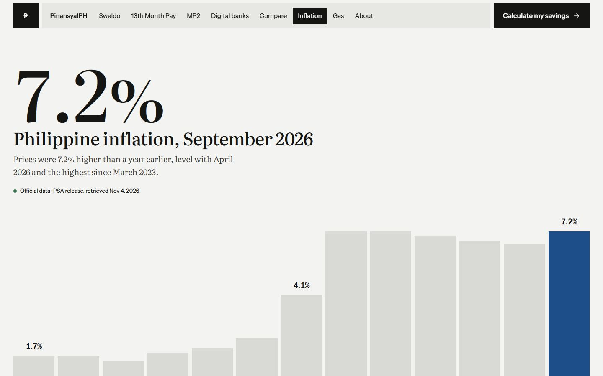
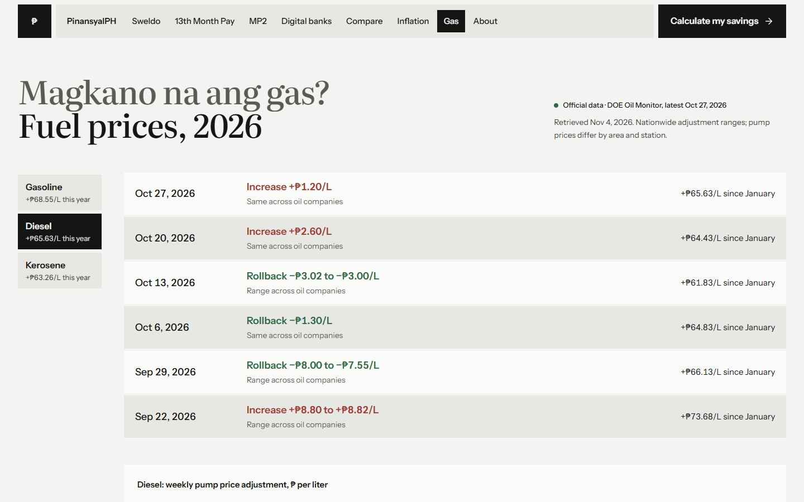
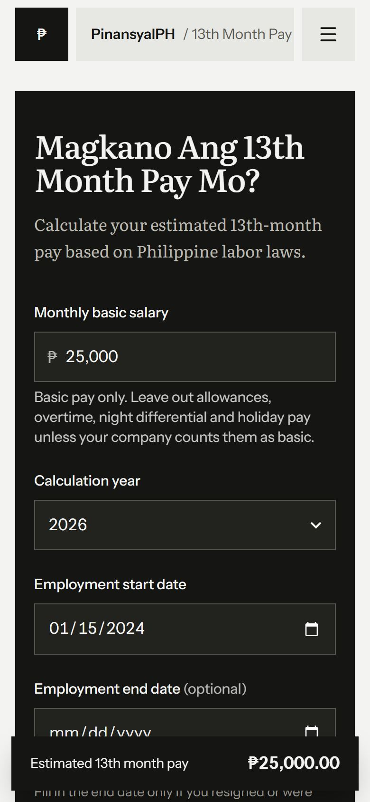

<div align="center">



<br />

**Worth it ba sa Pilipinas? Understand your money with numbers you can check.**

Free, open-source tools to explore your salary, 13th month pay, savings, and the impact of inflation — designed for everyday financial decisions in the Philippines.

**[Explore PinansyalPH](https://jervilangelo.github.io/pinansyalph-v2/)** · [See the calculators](#tools) · [How the numbers work](#how-the-numbers-are-calculated) · [Run locally](#run-it-locally)

<br />


</div>

> **Educational use only.** This is not financial advice. Results are estimates based on published data and the assumptions you enter, not guaranteed returns or official payroll computations.

---

## Why this exists

I built PinansyalPH to promote **financial literacy**. Many of us learn about money the hard way: a payslip with
deductions we cannot explain, savings that look bigger every year but buy less, or a "high interest" promo with a cap
and an end date. Instead of telling you what to do with your money, PinansyalPH shows the arithmetic, using the same
numbers the PSA, DOE, Pag-IBIG, BIR and the banks publish, so you can see the trade-offs and decide for yourself.

It is open source because a tool about trust should be open to inspection. Anyone can check how a number is computed,
point out a mistake, or build on it.

## Tools

Every tool has its own focused page, uses sourced figures, and explains its calculations. Start with the question that matters to you.

| Page | What it does |
| --- | --- |
| [**Sweldo**](https://jervilangelo.github.io/pinansyalph-v2/sweldo) · *Saan napupunta ang sweldo ko?* | Take-home pay after SSS, PhilHealth, Pag-IBIG and BIR withholding, then your bills, savings and what is left, monthly or per payday. Includes a fuel estimator and charts. Inputs stay in your browser. |
| [**13th Month Pay**](https://jervilangelo.github.io/pinansyalph-v2/13th-month) · *Magkano Ang 13th Month Pay Mo?* | 13th month pay under PD 851: prorated for midyear hires and resignations, with salary changes, unpaid absences, the maternity salary differential and earlier installments. Separates earned from projected months, checks the ₱90,000 tax exemption, and explains the rules in plain Taglish. |
| [**MP2**](https://jervilangelo.github.io/pinansyalph-v2/mp2) · *Lumago nga ba talaga?* | Pag-IBIG MP2 projections with the latest declared rate, the five-year average or your own, then what the result is worth in today's pesos. |
| [**Digital banks**](https://jervilangelo.github.io/pinansyalph-v2/banks) · *Saan mas sulit mag-ipon?* | Digital bank savings with verified base rates, promos with caps and end dates, and the 20% final withholding tax. |
| [**Compare**](https://jervilangelo.github.io/pinansyalph-v2/compare) | MP2 and bank products side by side on the same plan, in pesos or in today's pesos. Nothing is ranked by headline rate. |
| [**Inflation**](https://jervilangelo.github.io/pinansyalph-v2/inflation) | Headline, core, food and transport inflation from PSA since 2019, with the BSP target band. |
| [**Gas**](https://jervilangelo.github.io/pinansyalph-v2/gas) · *Magkano na ang gas?* | Weekly DOE pump price adjustments for gasoline, diesel and kerosene, and the year-to-date net change. |
| [**About**](https://jervilangelo.github.io/pinansyalph-v2/about) | Why the project exists, its principles, how to contribute, and the FAQ. |

Amounts you enter in MP2 carry over to Digital banks and Compare, so every comparison uses the same inputs. Every
figure shows its source, reference period and retrieval date; nothing is labelled "live".

## See it in action

Explore the actual application screens — from payroll to purchasing power.

| 13th month pay | Sweldo |
| --- | --- |
|  |  |
| **MP2** | **Real value** |
|  |  |
| **Inflation** | **Gas** |
|  |  |

Works on phones, tablets and desktops; tested at widths from 360px to 1920px.



## How the numbers are calculated

Full detail with formulas and legal references: **[docs/METHODOLOGY.md](docs/METHODOLOGY.md)**. In short:

- **Sweldo**: employee shares only (SSS 5% of the salary credit, PhilHealth 2.5% within its floor and ceiling, Pag-IBIG
  up to ₱200), then the BIR withholding table for your pay frequency on pay net of those contributions. Savings are
  kept apart from expenses.
- **13th month pay**: total eligible basic salary earned in the calendar year ÷ 12 (PD 851; DOLE Labor Advisory No. 16,
  s. 2025). Partial months are estimated by calendar days unless you enter the actual payslip figure. 13th month pay
  and other benefits are tax-exempt up to ₱90,000 combined (NIRC Sec. 32(B)(7)(e), as amended by TRAIN); only the
  excess becomes taxable compensation, taxed at the graduated rates.
- **MP2**: dividends accrue monthly at the declared annual rate ÷ 12 on your balance, are credited every December and at
  maturity, and are tax-free.
- **Banks**: interest = balance × rate × days ÷ the bank's day-count basis, credited daily or monthly, minus 20% final
  withholding tax (RA 12214). Promos apply only up to their cap and until their end date.
- **Real value**: `real = nominal ÷ (1 + inflation)^years`, built month by month, with each contribution valued at the
  month it was made.

Money is computed with decimal.js and rounded to centavos only where a real institution would round.

## Data sources and updates

| Data | Source | Latest in this repo | Refresh |
| --- | --- | --- | --- |
| Inflation and purchasing power of the peso | [PSA OpenSTAT](https://openstat.psa.gov.ph/), 2018-based CPI | September 2026 | Daily check, plus a second pass on days 1–10 of each month |
| Fuel price adjustments | [DOE Oil Monitor](https://doe.gov.ph/data-and-prices/liquid-fuels/oil-monitor) | Week of 27 October 2026 | Daily check |
| MP2 dividend rates (2011–2025) | Pag-IBIG Fund declarations | 2025: 7.12%, declared 27 Feb 2026 | Daily watch; added by hand |
| Bank savings rates | Each bank's official page or product disclosure | Verified 4 November 2026 | Daily evidence check; changed by hand |
| Payroll and tax rules (SSS, PhilHealth, Pag-IBIG, BIR, ₱90,000 benefits ceiling) | SSS Circular 2024-006, PhilHealth Circular 2020-0005, HDMF Circular 460, BIR RR 11-2018, RA 10963 | In force since 2025-01-01 / 2024-01-01 / 2024-02-01 / 2023-01-01 | Versioned by hand in `src/data/payroll.json` |

The [`Update economic data`](.github/workflows/update-economic-data.yml) workflow runs daily. It retrieves each source,
validates it against the schemas in [`src/types/data.ts`](src/types/data.ts), keeps the previous file if anything
fails, and commits only real changes; the deploy workflow then rebuilds the site.

- **Bank rates are never published automatically.** The job only checks that the text recorded at manual verification
  is still on the bank's page. If it disappears, the product is marked *under review*; after 45 days without
  re-verification, *may be outdated*. To update a rate, edit [`src/data/banks.json`](src/data/banks.json) after checking
  the official page.
- **Payroll and tax rules**: when an agency issues a new schedule, or the ₱90,000 ceiling changes by law, add a new
  version with its `effectiveFrom` date and source to [`src/data/payroll.json`](src/data/payroll.json). No code changes
  are needed.
- **MP2**: when a new year's rate is due (from April onward), the job flags it. Add it to
  [`src/data/mp2.json`](src/data/mp2.json).

## Run it locally

Requires Node.js 22 or newer.

```bash
npm install
npm run dev            # http://localhost:5173
```

Other commands:

```bash
npm test               # unit tests: calculators and data parsers
npm run test:e2e       # browser tests against the production build
PW_CHANNEL=chrome npm run test:e2e   # use an installed Chrome instead of Playwright's Chromium
npm run validate:data  # schema-check every dataset
npm run data:update    # fetch PSA, DOE, MP2 and bank checks, then validate
npm run build          # production build in dist/
npm run lint
```

## Technology

| Layer | Choice |
| --- | --- |
| App | React 19, TypeScript, Vite; one page per tool with a small built-in router |
| Styling and motion | Tailwind CSS v4, Motion (respects reduced-motion settings) |
| Charts | Recharts, lazy-loaded |
| Money | decimal.js |
| Data contracts | zod schemas shared by the site and the data scripts |
| Data ingestion | Node scripts run by GitHub Actions; pdf.js for DOE PDFs |
| Tests | Vitest (111 unit tests), Playwright (52 browser tests) |
| Hosting | GitHub Pages via GitHub Actions |

Architecture and the reasons for it: [docs/ARCHITECTURE.md](docs/ARCHITECTURE.md).

## Deploy

Pushing to `main` runs [`deploy.yml`](.github/workflows/deploy.yml): data validation, lint, unit tests, browser tests,
build, then deployment to GitHub Pages. The build writes a copy of the page for every route, so links like
`/pinansyalph-v2/mp2` open directly.

One-time setup for a fork or a new copy:

1. **Settings → Pages → Source**: choose **GitHub Actions**.
2. **Settings → Actions → General → Workflow permissions**: choose **Read and write permissions**, so the daily data
   job can commit updates.

The base path comes from GitHub Pages, so the site works under any repository name and at `/` with a custom domain.

## Limitations

- 13th month pay results are estimates for private-sector rank-and-file employees. Managerial and government employees
  follow different rules. Employers may compute partial months differently; enter your payslip figures for those
  months.
- The ₱90,000 exemption is the ceiling in force as of November 2026. Bills to raise it had not been enacted.
- MP2 projections follow the average-balance method Pag-IBIG describes publicly. They are not Pag-IBIG's official
  computation, and future dividend rates are unknown.
- Bank projections assume today's base rate continues. Banks can change rates at any time.
- Salary results are estimates. Actual payroll depends on how an employer classifies compensation, which payday
  contributions are taken, and year-end annualisation.
- DOE reports adjustments, not one national pump price, so no fuel percentage change is shown.
- Inflation assumptions are applied uniformly to future years.
- The Pag-IBIG website blocks automated access, so MP2 rates are recorded from reported declarations.
- MariBank, UNO and OwnBank rates could not be confirmed on their official pages and are listed as excluded.

## Contributing

Issues and pull requests are welcome:

- Data corrections, such as a changed bank rate or a new MP2 declaration (please link the official source)
- Bug reports and fixes
- Copy fixes in Filipino or English
- Accessibility improvements
- Ideas for new financial literacy tools

[Open an issue](https://github.com/jervilangelo/pinansyalph-v2/issues) to start.

## Credits

Built by **[Jervil Angelo De Leon](https://github.com/jervilangelo)** to make financial literacy easier to explore, verify and understand in the Philippines.

If you find these tools useful, consider [starring PinansyalPH on GitHub](https://github.com/jervilangelo/pinansyalph-v2).

Photographs from Wikimedia Commons, credited on the site and listed in
[docs/image-credits.json](docs/image-credits.json). Not affiliated with PSA, DOE, Pag-IBIG Fund, BIR, SSS, PhilHealth
or any bank.
