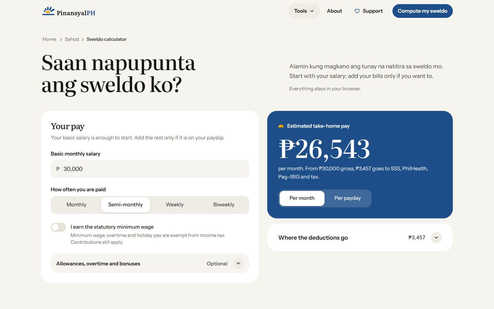
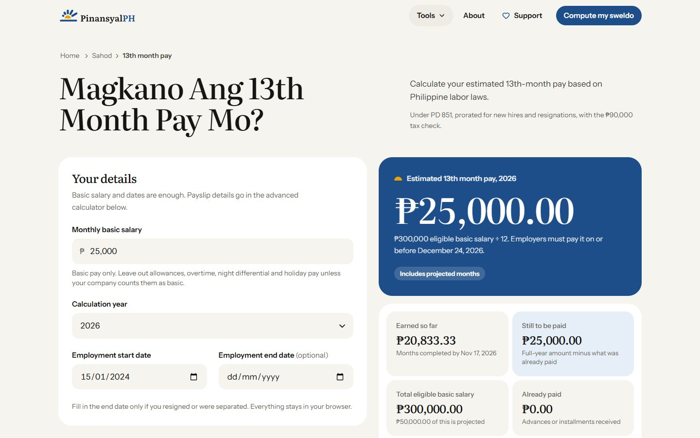
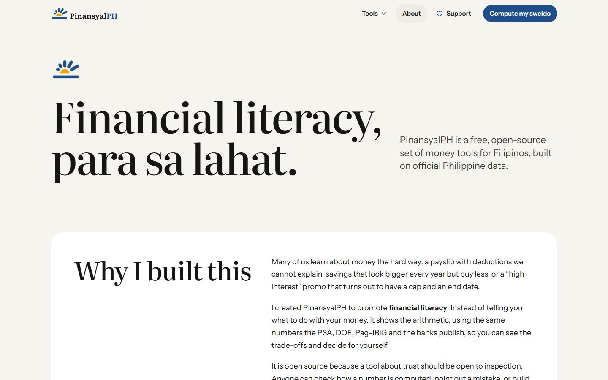
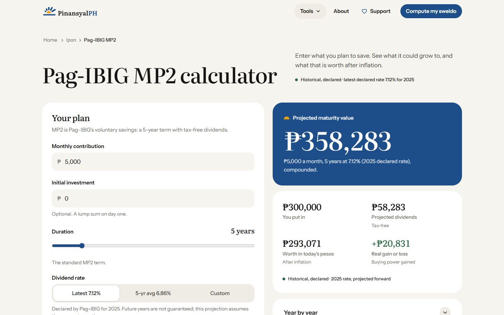
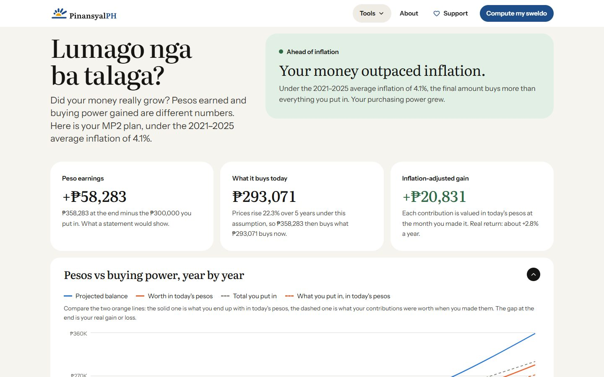
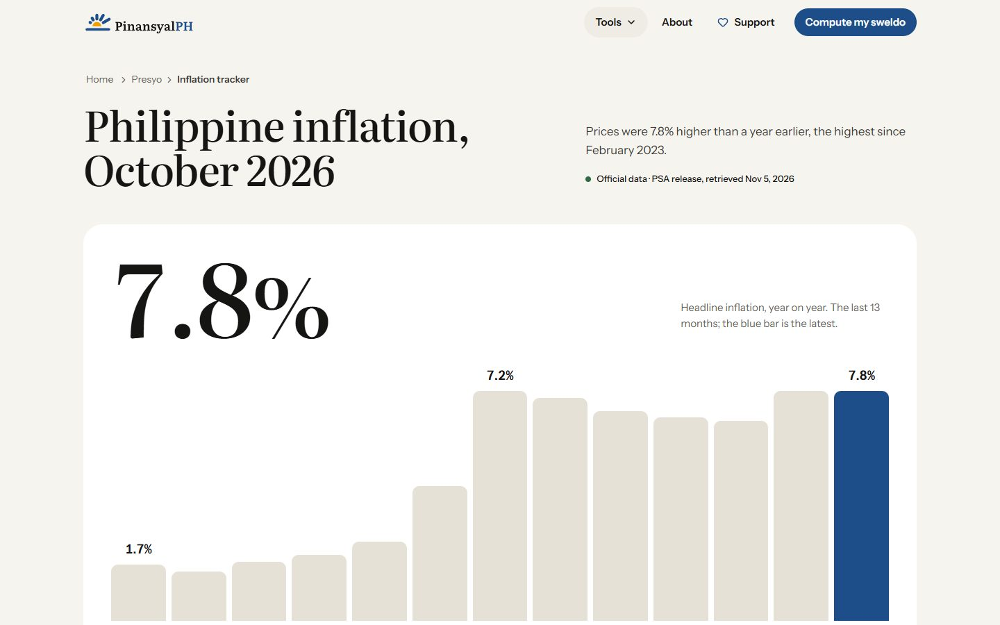
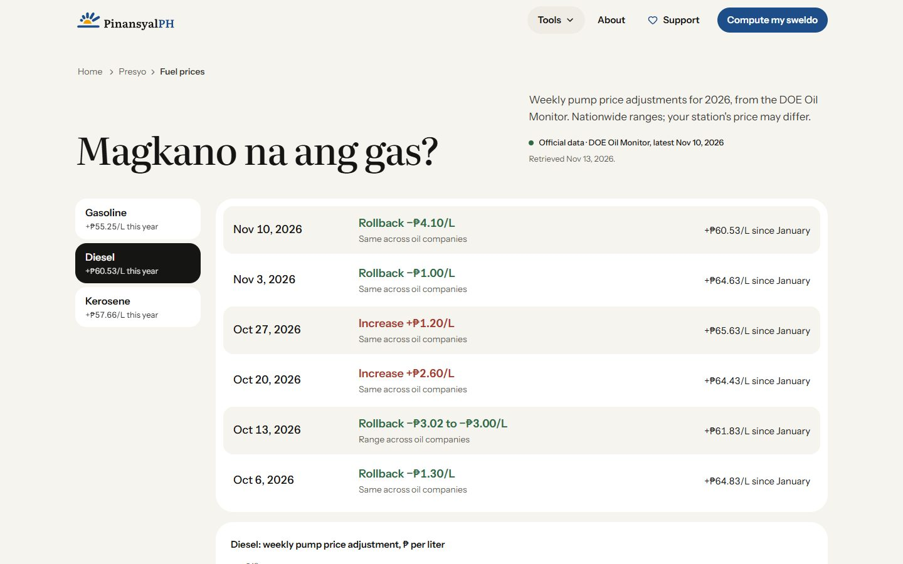
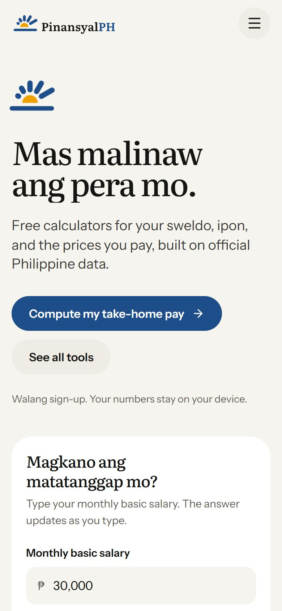

<div align="center">


<br />

**Mas malinaw ang pera mo.** Understand your money with numbers you can check.

Free, open-source tools to explore your salary, 13th month pay, savings, and the impact of inflation — designed for everyday financial decisions in the Philippines.

**[Explore PinansyalPH](https://jervilangelo.github.io/pinansyalph-v2/)** · [See the calculators](#tools) · [How the numbers work](#how-the-numbers-are-calculated) · [Run locally](#run-it-locally)

<br />


</div>

> **Educational use only.** This is not financial advice. Results are estimates based on published data and the assumptions you enter, not guaranteed returns or official payroll computations.

---

## Why this exists

I built PinansyalPH to promote **financial literacy**. Many of us learn about money the hard way: a payslip with
deductions we cannot explain, savings that look bigger every year but buy less, or a "high interest" promo with a cap
and an end date. Instead of telling you what to do with your money, PinansyalPH shows the arithmetic, using the same
numbers the PSA, DOE, Pag-IBIG, BIR and the banks publish, so you can see the trade-offs and decide for yourself.

It is open source because a tool about trust should be open to inspection. Anyone can check how a number is computed,
point out a mistake, or build on it.

## What's new in Version 3

PinansyalPH v3 is a complete redesign of the interface. The calculations, datasets and data workflows are unchanged.

- **A calmer, lighter design** built on the new brand kit in [`src/kit`](src/kit): warm off-white ground, white panels separated by tone, the brand blue for actions and answers, Literata for headlines and peso figures.
- **The answer first.** Every tool opens with one input panel and one large result. Breakdowns, year-by-year tables, methodology and secondary charts open on request.
- **Easier to find your way.** Tools are grouped into three plain questions: *Sahod* (pay), *Ipon* (savings) and *Presyo* (prices), with one Tools menu on desktop and a full-screen menu on phones.
- **A live estimator on the homepage.** Type your salary to see your take-home pay, then carry it into the full Sweldo calculator.
- **An animated logo and branded loading screen.** The rays of the logo rise over the sun like a growing bar chart. The splash paints before the app loads, leaves as soon as the page is ready, skips the long intro on reloads, and respects reduced-motion settings.
- **Support PinansyalPH.** A new About page with a support dialog that links to the repository to star it, and to the developer's portfolio.

Version 2 stays recoverable: tag [`v2-final`](https://github.com/jervilangelo/pinansyalph-v2/tree/v2-final) and branch `v2-archive`. Full notes: [docs/RELEASE-v3.md](docs/RELEASE-v3.md).

## Tools

Every tool has its own focused page, uses sourced figures, and explains its calculations. Start with the question that matters to you.

| Page | What it does |
| --- | --- |
| [**Sweldo**](https://jervilangelo.github.io/pinansyalph-v2/sweldo) · *Saan napupunta ang sweldo ko?* | Take-home pay after SSS, PhilHealth, Pag-IBIG and BIR withholding, then your bills, savings and what is left, monthly or per payday. Includes a fuel estimator and charts. Inputs stay in your browser. |
| [**Underpaid ba ko?**](https://jervilangelo.github.io/pinansyalph-v2/underpaid-ba-ko) · *Alamin kung competitive ang sweldo mo.* | Compares your basic pay and regular allowances with PSA's Occupational Wages Survey for your job, region and industry, in pesos and percent, with the survey period, coverage and definitions shown. Says plainly when PSA has no benchmark for your job. Includes **Sulit ba ang job offer?**, which compares take-home pay and commute costs of your current job and an offer. |
| [**13th Month Pay**](https://jervilangelo.github.io/pinansyalph-v2/13th-month) · *Magkano Ang 13th Month Pay Mo?* | 13th month pay under PD 851: prorated for midyear hires and resignations, with salary changes, unpaid absences, the maternity salary differential and earlier installments. Separates earned from projected months, checks the ₱90,000 tax exemption, and explains the rules in plain Taglish. |
| [**MP2**](https://jervilangelo.github.io/pinansyalph-v2/mp2) · *Lumago nga ba talaga?* | Pag-IBIG MP2 projections with the latest declared rate, the five-year average or your own, then what the result is worth in today's pesos. |
| [**Digital banks**](https://jervilangelo.github.io/pinansyalph-v2/banks) · *Saan mas sulit mag-ipon?* | Digital bank savings with verified base rates, promos with caps and end dates, and the 20% final withholding tax. |
| [**Compare**](https://jervilangelo.github.io/pinansyalph-v2/compare) | MP2 and bank products side by side on the same plan, in pesos or in today's pesos. Nothing is ranked by headline rate. |
| [**Inflation**](https://jervilangelo.github.io/pinansyalph-v2/inflation) | Headline, core, food and transport inflation from PSA since 2019, with the BSP target band. |
| [**Gas**](https://jervilangelo.github.io/pinansyalph-v2/gas) · *Magkano na ang gas?* | Weekly DOE pump price adjustments for gasoline, diesel and kerosene, and the year-to-date net change. |
| [**Toll**](https://jervilangelo.github.io/pinansyalph-v2/magkano-ang-toll) · *Magkano ang Toll Ko? Alamin ang toll fee bago bumiyahe.* | Toll from any entry plaza to any exit on NLEX–SCTEX, TPLEX, Skyway Stage 3, Skyway–SLEX, STAR, CALAX, CAVITEX and the NLEX Connector, by vehicle class, one way or balikan. Trips across expressways are split per road, the RFID load is shown per account (Easytrip, Autosweep), routes can be saved in your browser, and fuel can be added for a total travel cost. |
| [**Kuryente**](https://jervilangelo.github.io/pinansyalph-v2/magkano-kuryente) · *Magkano Kuryente Ko? Tama ba ang singil sa bill mo?* | Checks a Meralco residential bill against Meralco's published rates for the billing month, line by line (generation, transmission, system loss, distribution tiers, refunds, subsidies, taxes, universal charges), from kWh or meter readings. Shows the difference in pesos and percent with ordinary reasons, never a verdict. Also: an appliance calculator, a two-bill comparison that splits a change into usage and rate, and a savings simulator priced with the real tariff. Other providers use a typed rate, labelled an estimate. |
| [**Bahay**](https://jervilangelo.github.io/pinansyalph-v2/magkano-bahay) · *Magkano Bahay Ngayon?* | Official BSP median prices of houses and condominium units by area (Q2 2026), with the number of bank loans behind each figure; a location comparison; BSP price-index trends; “Overpriced ba ’to?”, which compares an asking price with the area median without passing judgment; and “Kaya ko ba?”, a home loan amortization and affordability calculator. Says “Insufficient verified market data” where no official figure exists (city-level, per square meter, lots). |
| [**Subscriptions**](https://jervilangelo.github.io/pinansyalph-v2/magkano-subscription) · *Magkano ba Subscription Ko? Akala mo maliit lang?* | A subscription tracker with a directory of 42 services and their official Philippine prices. Monthly, quarterly and yearly plans are normalised to a monthly cost, shared plans count only your share, and you can always type what you actually pay. Shows monthly, yearly and weekly totals, a category breakdown, what cancelling would save, a budget and upcoming renewals. Saved only in your browser. |
| [**Konsumo**](https://jervilangelo.github.io/pinansyalph-v2/magkano-konsumo) · *Magkano Konsumo Ko?* | Appliance electricity costs a day, a month and a year, from typical ratings or an energy label, with indicative Meralco and Visayan Electric residential rates or your own. A household list with the biggest users, and a "what if I use it less" simulator. Saved only in your browser. |
| [**Internet**](https://jervilangelo.github.io/pinansyalph-v2/sulit-internet) · *Sulit Ba Internet Ko?* | Your internet plan's ₱ per Mbps against verified plans from PLDT Fiber Prepaid, Globe GFiber, Converge, Starlink, Smart and DITO, with first-year and contract costs, installation and promos, side-by-side comparison, custom plans and saved comparisons. |
| [**About**](https://jervilangelo.github.io/pinansyalph-v2/about) | Why the project exists, its principles, how to contribute, and the FAQ. |

Amounts you enter in MP2 carry over to Digital banks and Compare, so every comparison uses the same inputs. Every
figure shows its source, reference period and retrieval date; nothing is labelled "live".

## See it in action

Explore the actual application screens — from payroll to purchasing power.

| Home | Sweldo |
| --- | --- |
|  |  |
| **13th month pay** | **About** |
|  |  |
| **MP2** | **Real value** |
|  |  |
| **Inflation** | **Gas** |
|  |  |

Works on phones, tablets and desktops; tested at widths from 320px to 1920px.



## How the numbers are calculated

Full detail with formulas and legal references: **[docs/METHODOLOGY.md](docs/METHODOLOGY.md)**. In short:

- **Sweldo**: employee shares only (SSS 5% of the salary credit, PhilHealth 2.5% within its floor and ceiling, Pag-IBIG
  up to ₱200), then the BIR withholding table for your pay frequency on pay net of those contributions. Savings are
  kept apart from expenses.
- **13th month pay**: total eligible basic salary earned in the calendar year ÷ 12 (PD 851; DOLE Labor Advisory No. 16,
  s. 2025). Partial months are estimated by calendar days unless you enter the actual payslip figure. 13th month pay
  and other benefits are tax-exempt up to ₱90,000 combined (NIRC Sec. 32(B)(7)(e), as amended by TRAIN); only the
  excess becomes taxable compensation, taxed at the graduated rates.
- **MP2**: dividends accrue monthly at the declared annual rate ÷ 12 on your balance, are credited every December and at
  maturity, and are tax-free.
- **Banks**: interest = balance × rate × days ÷ the bank's day-count basis, credited daily or monthly, minus 20% final
  withholding tax (RA 12214). Promos apply only up to their cap and until their end date.
- **Real value**: `real = nominal ÷ (1 + inflation)^years`, built month by month, with each contribution valued at the
  month it was made.

Money is computed with decimal.js and rounded to centavos only where a real institution would round.

## Data sources and updates

| Data | Source | Latest in this repo | Refresh |
| --- | --- | --- | --- |
| Inflation and purchasing power of the peso | [PSA OpenSTAT](https://openstat.psa.gov.ph/), 2018-based CPI | September 2026 | Daily check, plus a second pass on days 1–10 of each month |
| Fuel price adjustments | [DOE Oil Monitor](https://doe.gov.ph/data-and-prices/liquid-fuels/oil-monitor) | Week of 27 October 2026 | Daily check |
| MP2 dividend rates (2011–2025) | Pag-IBIG Fund declarations | 2025: 7.12%, declared 27 Feb 2026 | Daily watch; added by hand |
| Bank savings rates | Each bank's official page or product disclosure | Verified 4 November 2026 | Daily evidence check; changed by hand |
| Occupational wages (Underpaid ba ko?) | [PSA OpenSTAT](https://openstat.psa.gov.ph/), Occupational Wages Survey: 8 tables | 2024 OWS (August 2024); 2022 OWS for accounting and bookkeeping clerks and medians | Weekly check |
| Expressway tolls (Magkano ang Toll Ko?) | [Toll Regulatory Board](https://trb.gov.ph/index.php/toll-rates) matrices, as transcribed by [ExpresswayPH](https://expresswayph.com/matrix) and checked against news reports of each TRB approval | NLEX–SCTEX 20 Jan 2026; Skyway–SLEX and STAR 1 Jul 2026; TPLEX 8 Jul 2026; others in [docs/TOLL-DATA.md](docs/TOLL-DATA.md) | By hand when TRB approves new rates |
| Housing prices (Magkano Bahay Ngayon?) | [BSP Residential Property Price Index report](https://www.bsp.gov.ph/Media_And_Research/RPPI/RPPI-Report-2026-Q2.pdf) | Q2 2026 (published September 2026) | By hand each quarter, see [docs/HOUSING-DATA.md](docs/HOUSING-DATA.md) |
| Electricity rates (Magkano Kuryente Ko?) | Meralco's monthly [Summary Schedule of Rates and Residential Bills at Typical Consumption Levels](https://www.meralco.com.ph/residential/rates-and-charges) | August to November 2026 billing (₱15.5510/kWh at 200 kWh in November) | By hand each month, see [docs/ELECTRICITY-DATA.md](docs/ELECTRICITY-DATA.md) |
| Subscription prices (Magkano ba Subscription Ko?) | Each service's own Philippine pricing page (Spotify, Netflix, Disney+, YouTube, Apple, Google One, Microsoft 365, Adobe, ChatGPT and others) | Checked 18 November 2026 | By hand; see `src/data/subscriptions.ts` |
| Internet plans (Sulit Ba Internet Ko?) | Each provider's own plan page or press release | Checked 18 November 2026 | By hand; see docs/METHODOLOGY.md §15 |
| Indicative electricity rates (Magkano Konsumo Ko?) | Meralco rate schedule; Visayan Electric newsroom | Meralco November 2026; Visayan Electric September 2026 | Monthly (Meralco); by hand (Visayan Electric) |
| Payroll and tax rules (SSS, PhilHealth, Pag-IBIG, BIR, ₱90,000 benefits ceiling) | SSS Circular 2024-006, PhilHealth Circular 2020-0005, HDMF Circular 460, BIR RR 11-2018, RA 10963 | In force since 2025-01-01 / 2024-01-01 / 2024-02-01 / 2023-01-01 | Versioned by hand in `src/data/payroll.json` |

The [`Update economic data`](.github/workflows/update-economic-data.yml) workflow runs daily. It retrieves each source,
validates it against the schemas in [`src/types/data.ts`](src/types/data.ts), keeps the previous file if anything
fails, and commits only real changes; the deploy workflow then rebuilds the site.

- **Bank rates are never published automatically.** The job only checks that the text recorded at manual verification
  is still on the bank's page. If it disappears, the product is marked *under review*; after 45 days without
  re-verification, *may be outdated*. To update a rate, edit [`src/data/banks.json`](src/data/banks.json) after checking
  the official page.
- **Payroll and tax rules**: when an agency issues a new schedule, or the ₱90,000 ceiling changes by law, add a new
  version with its `effectiveFrom` date and source to [`src/data/payroll.json`](src/data/payroll.json). No code changes
  are needed.
- **Salary benchmarks**: the [`Update salary data`](.github/workflows/update-salary-data.yml) workflow runs
  `npm run data:salary` weekly. It keeps the previous file if PSA is unreachable, a table changes shape, a region or
  industry label is unknown, validation fails, or far fewer figures come back. Job title mapping is edited by hand in
  [`src/data/salaryOccupations.ts`](src/data/salaryOccupations.ts).
- **Housing figures are updated by hand each quarter** from BSP's RPPI report, which blocks automated access. The
  unit tests check the transcription; see [docs/HOUSING-DATA.md](docs/HOUSING-DATA.md).
- **Electricity rates are updated by hand each month.** Meralco's website uses bot protection, so there is no
  scheduled job. `npm run data:electricity` builds a month from Meralco's two PDFs and writes it only if it reproduces
  all 18 of Meralco's worked bills; see [docs/ELECTRICITY-DATA.md](docs/ELECTRICITY-DATA.md). The page says when a
  newer billing month has started.
- **Toll rates are updated by hand.** TRB's site does not allow automated access, so there is no scheduled job. When
  TRB approves new rates, update [`src/data/tolls.json`](src/data/tolls.json) as described in
  [docs/TOLL-DATA.md](docs/TOLL-DATA.md); `npm run validate:data` and the unit tests check every matrix.
- **MP2**: when a new year's rate is due (from April onward), the job flags it. Add it to
  [`src/data/mp2.json`](src/data/mp2.json).

## Run it locally

Requires Node.js 22 or newer.

```bash
npm install
npm run dev            # http://localhost:5173
```

Other commands:

```bash
npm test               # unit tests: calculators and data parsers
npm run test:e2e       # browser tests against the production build
PW_CHANNEL=chrome npm run test:e2e   # use an installed Chrome instead of Playwright's Chromium
npm run validate:data  # schema-check every dataset
npm run data:salary    # fetch PSA Occupational Wages Survey benchmarks
npm run data:update    # fetch PSA, DOE, MP2, bank checks and salary benchmarks, then validate
npm run build          # production build in dist/
npm run lint
```

## Technology

| Layer | Choice |
| --- | --- |
| App | React 19, TypeScript, Vite; one page per tool with a small built-in router |
| Styling and motion | Tailwind CSS v4 design tokens, Motion with shared timing and easing (respects reduced-motion settings) |
| Brand | Logo kit in `src/kit`; favicons, app icons, manifest and social image in `public/` |
| Charts | Recharts, lazy-loaded |
| Money | decimal.js |
| Data contracts | zod schemas shared by the site and the data scripts |
| Data ingestion | Node scripts run by GitHub Actions; pdf.js for DOE PDFs |
| Tests | Vitest (261 unit tests), Playwright (162 browser tests) |
| Hosting | GitHub Pages via GitHub Actions |

Architecture and the reasons for it: [docs/ARCHITECTURE.md](docs/ARCHITECTURE.md).

## Deploy

Pushing to `main` runs [`deploy.yml`](.github/workflows/deploy.yml): data validation, lint, unit tests, browser tests,
build, then deployment to GitHub Pages. The build writes a copy of the page for every route, so links like
`/pinansyalph-v2/mp2` open directly.

One-time setup for a fork or a new copy:

1. **Settings → Pages → Source**: choose **GitHub Actions**.
2. **Settings → Actions → General → Workflow permissions**: choose **Read and write permissions**, so the daily data
   job can commit updates.

The base path comes from GitHub Pages, so the site works under any repository name and at `/` with a custom domain.

## Limitations

- 13th month pay results are estimates for private-sector rank-and-file employees. Managerial and government employees
  follow different rules. Employers may compute partial months differently; enter your payslip figures for those
  months.
- The ₱90,000 exemption is the ceiling in force as of November 2026. Bills to raise it had not been enacted.
- MP2 projections follow the average-balance method Pag-IBIG describes publicly. They are not Pag-IBIG's official
  computation, and future dividend rates are unknown.
- Bank projections assume today's base rate continues. Banks can change rates at any time.
- Salary results are estimates. Actual payroll depends on how an employer classifies compensation, which payday
  contributions are taken, and year-end annualisation.
- DOE reports adjustments, not one national pump price, so no fuel percentage change is shown.
- Inflation assumptions are applied uniformly to future years.
- The Pag-IBIG website blocks automated access, so MP2 rates are recorded from reported declarations.
- **Underpaid ba ko?** is a market comparison, not a legal finding, and not a minimum-wage check. PSA's open OWS
  tables cover three benchmark occupations (general office clerks, elementary occupations, and, from 2022,
  accounting and bookkeeping clerks); every other job is compared with all time-rated workers in its region or
  industry. The figures describe August 2024 (or 2022), mix all experience levels, exclude the public sector, and come
  with no percentiles or sample sizes, so none are shown. Details: [docs/METHODOLOGY.md](docs/METHODOLOGY.md#9-salary-comparison-underpaid-ba-ko).
- **Magkano ang Toll Ko?** gives TRB-approved fares, not what a plaza will charge on the day. NAIAX, NLEX Harbor Link
  and MCX as its own road are not included, CAVITEX and Skyway Stage 3 have plaza pairs with no published fare, and
  Skyway Stage 3 uses the provisional rates from 2021. Details: [docs/TOLL-DATA.md](docs/TOLL-DATA.md).
- **Magkano Kuryente Ko?** covers Meralco residential customers. It matches Meralco's own worked bills within 2
  centavos up to 400 kWh (₱0.30 at most, at 5,000 kWh), because Meralco publishes rounded VAT rates. Local
  franchise tax depends on the city. Cooperatives and other utilities use a typed rate. A difference from the
  published rates is not proof of an error.
- **Magkano Bahay Ngayon?** shows BSP medians for seven areas, not cities or barangays, and only for homes bought with
  bank loans. No asking-price listings or machine-learning estimates are used: the reviewed listing datasets have no
  verifiable reuse licence and the models' errors are about 25% of the price. See [docs/HOUSING-DATA.md](docs/HOUSING-DATA.md).
- **Magkano ba Subscription Ko?** only pre-fills prices a service publishes in pesos for the Philippines. Services
  that bill in US dollars (Claude, Notion, Dropbox, Perplexity, GitHub Copilot, Grammarly Pro) and services priced
  only in the app (Viu, Crunchyroll, Tinder and others) need the amount you pay. Xbox Game Pass, PlayStation Plus and
  Nintendo Switch Online are not officially sold in the Philippines. Renewal reminders show on the page only.
- MariBank, UNO and OwnBank rates could not be confirmed on their official pages and are listed as excluded.

## Contributing

Issues and pull requests are welcome:

- Data corrections, such as a changed bank rate or a new MP2 declaration (please link the official source)
- Bug reports and fixes
- Copy fixes in Filipino or English
- Accessibility improvements
- Ideas for new financial literacy tools

[Open an issue](https://github.com/jervilangelo/pinansyalph-v2/issues) to start.

## Credits

Built by **[Jervil Angelo De Leon](https://github.com/jervilangelo)** to make financial literacy easier to explore, verify and understand in the Philippines.

If you find these tools useful, consider [starring PinansyalPH on GitHub](https://github.com/jervilangelo/pinansyalph-v2). More of my work: [jervilangelo.online](https://jervilangelo.online/).

Salary statistics: Philippine Statistics Authority, Occupational Wages Survey, via PSA OpenSTAT.

Photographs from Wikimedia Commons, credited on the site and listed in
[docs/image-credits.json](docs/image-credits.json). Not affiliated with PSA, DOE, Pag-IBIG Fund, BIR, SSS, PhilHealth
or any bank.
