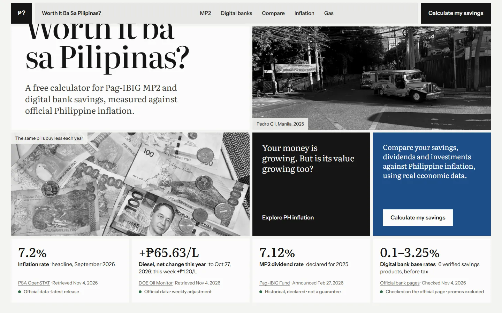
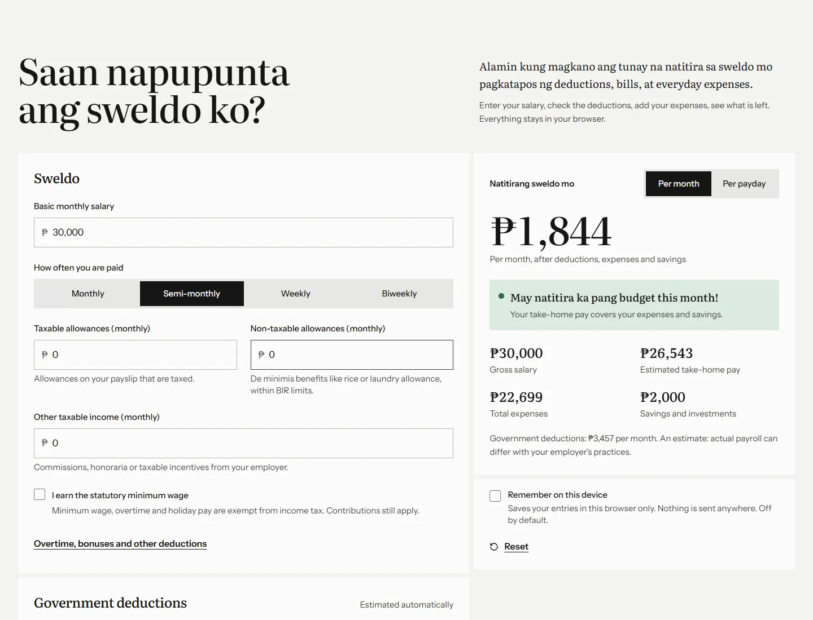
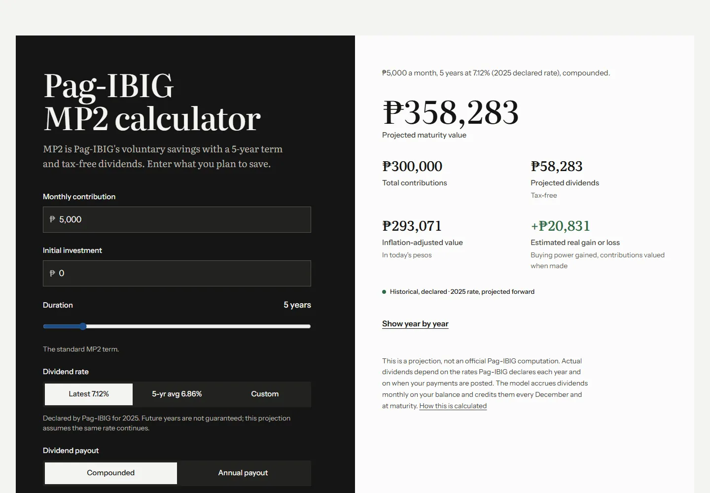
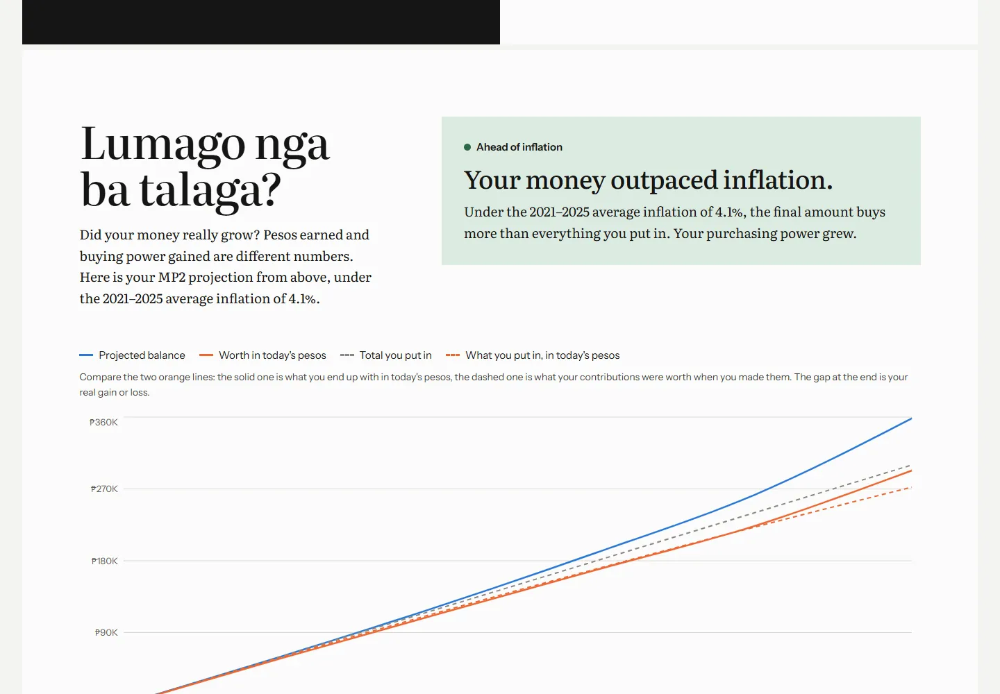
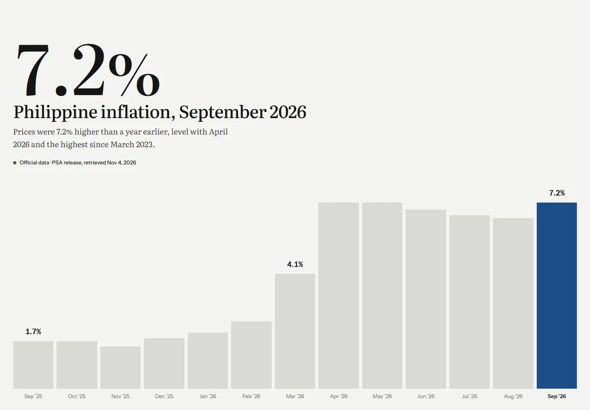
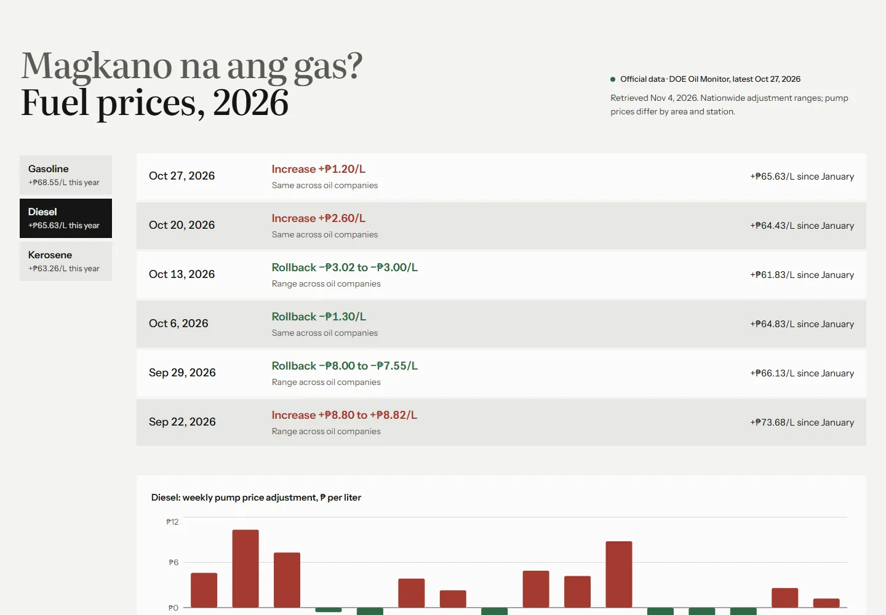

# PinansyalPH

**Worth it ba sa Pilipinas? Your money is growing. But is its value growing too?**

PinansyalPH is a free, open-source, no-sign-up set of money tools built to promote **financial literacy** for
Filipinos. It shows whether their savings actually keep their buying power. It compares
Pag-IBIG MP2 and digital bank savings against **official Philippine inflation**, after tax, using published data from
the Philippine Statistics Authority, the Department of Energy, Pag-IBIG Fund and each bank's own rate page.

**Live site:** https://jervilangelo.github.io/pinansyalph/

> Educational tool, not financial advice. Results are projections from published data and your assumptions, not actual
> earnings.



## Features

Each tool has its own page: `/sweldo`, `/mp2`, `/banks`, `/compare`, `/inflation`, `/gas`, plus `/about`.

- **Saan napupunta ang sweldo ko?** A salary and expenses calculator. Enter your pay, see SSS, PhilHealth, Pag-IBIG and
  BIR withholding estimated automatically from versioned official rules, add your monthly bills and savings, and see
  what is left, monthly or per payday. Includes a fuel estimator, custom expenses, three charts, and a link to project
  your leftover money in MP2 or digital banks. Inputs stay in your browser.
- **Pag-IBIG MP2 calculator.** Monthly, quarterly or yearly contributions, start month, payment timing, annual payout or
  compounding, and a choice of the latest declared rate, the five-year average or your own. It flags the standard
  five-year term and labels longer horizons as hypothetical.
- **Lumago nga ba talaga?** Nominal peso earnings, what the ending amount buys in today's pesos, and the
  inflation-adjusted gain, with each contribution valued at the month it was made. The message follows the numbers:
  positive, negative or neutral.
- **Digital bank savings.** Verified base rates, optional promos with caps and end dates, 20% final withholding tax,
  daily or monthly crediting, time deposits, and manual rate overrides.
- **MP2 vs banks.** Same contributions, same horizon, in pesos or in today's pesos, with notes on liquidity, tax and rate
  certainty. Products can be toggled; nothing is ranked by headline rate.
- **Philippine inflation tracker.** Latest headline, core, food and transport inflation from PSA with month-by-month
  history since 2019 and the BSP target band.
- **Magkano na ang gas?** Weekly DOE pump price adjustments for gasoline, diesel and kerosene, and DOE's year-to-date
  net change, kept separate from the inflation rate.
- **About.** Why the project exists (financial literacy), its principles, and how to contribute.
- Data indicators that always show the reference period, source, retrieval date and status. Nothing is labelled
  "live".



| MP2 calculator | Real value |
| --- | --- |
|  |  |
| **Inflation** | **Fuel** |
|  |  |

## Technology

| Layer | Choice |
| --- | --- |
| App | React 19, TypeScript, Vite |
| Styling and motion | Tailwind CSS v4, Motion (respects reduced motion) |
| Charts | Recharts, lazy-loaded |
| Money | decimal.js, centavo rounding only at credit and tax time |
| Data contracts | zod schemas shared by the site and the ingestion scripts |
| Ingestion | Node scripts run by GitHub Actions; pdf.js for DOE PDFs |
| Tests | Vitest (91 unit tests), Playwright (30 browser tests) |
| Hosting | GitHub Pages via GitHub Actions |

Architecture and the reasons for it: [docs/ARCHITECTURE.md](docs/ARCHITECTURE.md).

## How the numbers are calculated

Full detail with formulas: **[docs/METHODOLOGY.md](docs/METHODOLOGY.md)**. In short:

- **MP2**: dividends accrue monthly at the declared annual rate ÷ 12 on your balance (equal to rate × average monthly
  balance), are credited every December and at maturity, and are tax-free. Payment timing within the month is
  adjustable.
- **Banks**: interest = balance × rate × days ÷ the bank's day-count basis, credited daily or monthly, minus 20% final
  withholding tax (RA 12214). Promos apply only up to their cap and until their end date.
- **Real value**: `Real = Nominal ÷ (1 + inflation)^years`, built month by month from cumulative inflation factors.
- **Salary**: employee shares only (SSS 5% of the salary credit, PhilHealth 2.5% within its floor and ceiling, Pag-IBIG
  up to ₱200), then the BIR withholding table for your pay frequency on pay net of those contributions. Savings are
  kept apart from expenses.

## Data sources and refresh schedule

| Data | Source | Latest in this repo | Refresh |
| --- | --- | --- | --- |
| Inflation (headline, core, food, transport, purchasing power of the peso) | [PSA OpenSTAT](https://openstat.psa.gov.ph/) PxWeb API, 2018-based CPI | September 2026 | Daily check, plus a second pass on days 1–10 of each month |
| Fuel price adjustments and YTD net change | [DOE Oil Monitor](https://doe.gov.ph/data-and-prices/liquid-fuels/oil-monitor) | Week of 27 October 2026 | Daily check |
| MP2 dividend rates (2011–2025) | Pag-IBIG Fund declarations | 2025: 7.12%, declared 27 Feb 2026 | Daily watch; added by hand |
| Bank savings rates | Each bank's official page or product disclosure | Verified 4 November 2026 | Daily evidence check; changed by hand |
| Payroll rules (SSS, PhilHealth, Pag-IBIG, BIR) | SSS Circular 2024-006, PhilHealth Circular 2020-0005, HDMF Circular 460, BIR RR 11-2018 | In force since 2025-01-01 / 2024-01-01 / 2024-02-01 / 2023-01-01 | Versioned by hand in `src/data/payroll.json` |

### How official data and bank rates are updated

The [`Update economic data`](.github/workflows/update-economic-data.yml) workflow runs every day:

1. **Retrieve** each source.
2. **Validate** against the schemas in [`src/types/data.ts`](src/types/data.ts): no gaps, no future months, plausible
   values, every fuel read, and DOE's year-to-date totals reconciling week to week.
3. **Compare** with the stored dataset, ignoring the retrieval timestamp.
4. **Keep the previous file** if a source fails or validation fails, and report why in the job summary.
5. **Commit** only real changes; the deploy workflow then rebuilds the site.

The statistical **reference period** (e.g. "September 2026") and the **retrieval date** are stored separately and never
confused.

**Bank rates are never published automatically.** Marketing pages change wording and run time-limited promos, so the
job only checks that the exact text recorded at manual verification is still on the official page. If it disappears,
the product is marked *under review*; after 45 days without re-verification it is marked *may be outdated*. The last
verified rate stays in use and the interface shows the status. To update a rate, edit
[`src/data/banks.json`](src/data/banks.json) (rate, `evidence`, `verifiedOn`, `status`) after checking the official
page.

**Payroll rules**: when SSS, PhilHealth, Pag-IBIG or BIR issue a new schedule, add a new version with its
`effectiveFrom` date, issuance and source URL to [`src/data/payroll.json`](src/data/payroll.json). The calculator picks
the version in force on the pay date; no code changes are needed.

**MP2**: when a new year's rate is due (from April onward), the job flags it. Add the declared rate to
[`src/data/mp2.json`](src/data/mp2.json).

Banks not shown, and why, are listed in `banks.json` under `excluded` and on the site (MariBank, UNO Digital Bank,
OwnBank, Maya Personal Goals).

## Run it locally

Requires Node.js 22 or newer.

```bash
npm install
npm run dev            # http://localhost:5173
```

Other commands:

```bash
npm test               # unit tests: calculators and ingestion parsers
npm run test:e2e       # browser tests against the production build
PW_CHANNEL=chrome npm run test:e2e   # use an installed Chrome instead of Playwright's Chromium
npm run validate:data  # schema-check every dataset
npm run data:update    # fetch PSA, DOE, MP2 watch and bank checks, then validate
npm run build          # production build in dist/
npm run lint
```

## Deploy

Pushing to `main` runs [`deploy.yml`](.github/workflows/deploy.yml): dataset validation, lint, unit tests, browser
tests, build, then deployment to GitHub Pages.

One-time setup: in the repository's **Settings → Pages**, set **Source** to **GitHub Actions**. The build reads the
base path from GitHub Pages, so it works at `/pinansyalph/` today and at `/` if a custom domain is added
later. No custom domain is configured.

## Limitations

- MP2 projections follow the average-balance method Pag-IBIG describes publicly. They are not Pag-IBIG's official
  computation, and future dividend rates are unknown.
- Bank projections assume today's base rate continues. Banks can change rates at any time.
- DOE reports adjustments, not one national pump price, so no fuel percentage change is shown.
- Inflation assumptions are applied uniformly to future years.
- Salary results are estimates for regular employees. Actual payroll depends on how an employer classifies
  compensation, which payday contributions are taken, and year-end annualisation. PhilHealth and Pag-IBIG rules were
  cross-checked because their official documents could not be read by script.
- The Pag-IBIG website blocks automated access, so MP2 rates are recorded from reported declarations
  (`verified-secondary`).
- MariBank, UNO and OwnBank rates could not be confirmed on their official pages at the time of verification.

## Contributing

PinansyalPH is open source. Issues and pull requests are welcome: data corrections, new tools, copy fixes in Filipino
or English, and accessibility improvements.

## Credits

Photographs from Wikimedia Commons, credited on the site and listed in
[docs/image-credits.json](docs/image-credits.json). Not affiliated with PSA, DOE, Pag-IBIG Fund or any bank.
